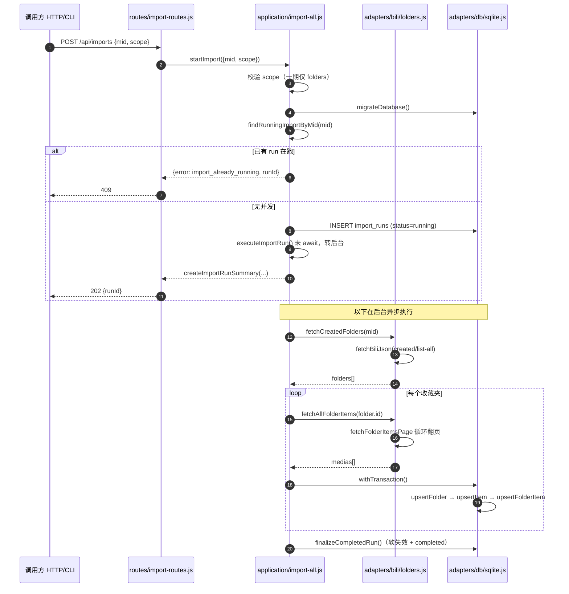
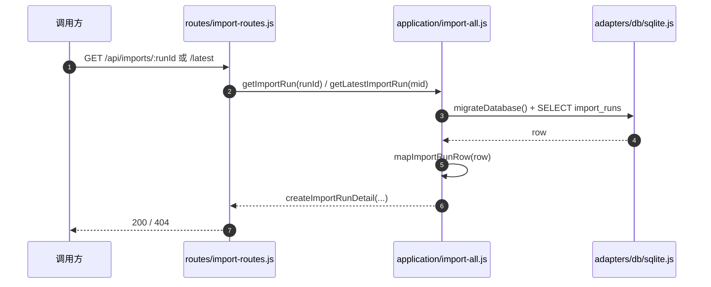
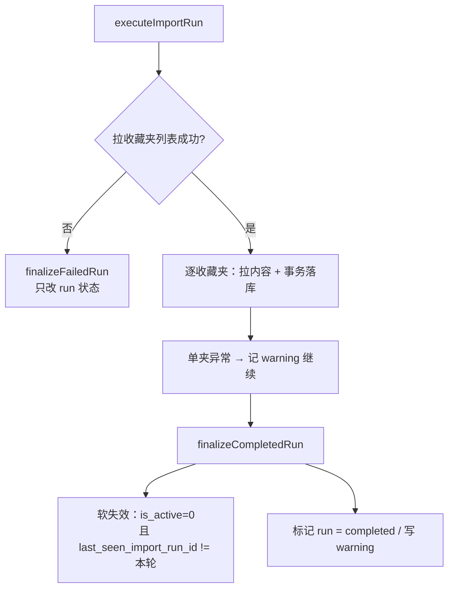

# `import-all` 输入输出契约

## 1. 目标

这个用例回答的是系统最基础的问题：

> 把当前账号下的收藏夹和收藏项，全量拉进本地，并落成一份来源数据快照。

它是整个系统的数据入口，也是 [初始化流程](file:///Users/dateng/pl-dashboard-2610/docs/project-plan.md#L205-L212) 的第 1 步。
在它跑通之前，工作区、归位建议、偏好分析都没有数据可谈。

## 2. 调用形态

导入被建模成一个**运行记录（run）**，而不是一次同步请求。

原因是一次全量导入要处理的请求量不小：收藏夹列表虽然一个请求就能拿到，但每个收藏夹还要按页拉收藏项。
按 48 个收藏夹、平均 2 页估算，大约是 100 次上游请求，同步等待很容易超时，也没法向用户交代进度。

所以分成三个接口：

```text
POST /api/imports            启动一次导入，立即返回
GET  /api/imports/:runId     查询某次导入的状态与结果
GET  /api/imports/latest     查询最近一次导入
```

### `POST /api/imports`

成功返回 `202 Accepted`：

```json
{
  "runId": "run_20261102_153001",
  "sourceMid": "39640918",
  "status": "running",
  "startedAt": "2026-11-02 15:30:01"
}
```

### `GET /api/imports/:runId`

```json
{
  "runId": "run_20261102_153001",
  "sourceMid": "39640918",
  "status": "completed",
  "startedAt": "2026-11-02 15:30:01",
  "finishedAt": "2026-11-02 15:30:38",
  "folderCount": 48,
  "itemCount": 1326,
  "warning": null
}
```

### 状态取值

一期只用三个值，和 `schema.js` 的 `importStatus` 保持一致：

| status      | 含义                                 |
| ----------- | ------------------------------------ |
| `running`   | 正在进行                             |
| `completed` | 导入流程已走完（可能带 warning）     |
| `failed`    | 导入无法完成，没有产出可用的来源数据 |

## 3. 输入

### Path / Query

| 字段    | 必填 | 说明           |
| ------- | ---- | -------------- |
| `runId` | 是   | 仅查询接口需要 |

### Body

```json
{
  "mid": "39640918",
  "scope": "folders"
}
```

| 字段    | 必填 | 说明                                             |
| ------- | ---- | ------------------------------------------------ |
| `mid`   | 否   | 不传则用配置里的默认账号，一期是单账号，通常不传 |
| `scope` | 否   | 一期固定 `folders`，稍后再看池见第 9 节          |

## 4. 输出

导入结果的正式结构（`GET` 返回的完整形态）：

```json
{
  "runId": "run_20261102_153001",
  "sourceMid": "39640918",
  "status": "completed",
  "startedAt": "2026-11-02 15:30:01",
  "finishedAt": "2026-11-02 15:30:38",
  "folderCount": 48,
  "itemCount": 1326,
  "warning": null
}
```

### 字段含义

- `folderCount`：本次成功落库的收藏夹数量
- `itemCount`：本次落库的**归属关系**数量，也就是「收藏夹 × 收藏项」的条目数
- `warning`：部分失败时为对象，正常时为 `null`

`itemCount` 特意定义成归属关系数，而不是视频主记录数。
因为视频主记录会去重（同一视频进两个收藏夹只留一条），
用户真正关心的是「我这次到底导进来多少条收藏」，那是对应归属关系的口径。

### 与设计文档 sketch 的差异

[codebase-design.md:L174-L184](file:///Users/dateng/pl-dashboard-2610/docs/codebase-design.md#L174-L184) 里最早写的是：

```ts
importAll(mid: string): Promise<ImportResult>
```

改成 run 资源之后，Module 接口变成：

```ts
interface ImportModule {
  startImport(mid?: string): Promise<ImportRunSummary>;
  getRun(runId: string): Promise<ImportRunDetail | null>;
  getLatestRun(mid?: string): Promise<ImportRunDetail | null>;
}
```

原来的 `ImportResult` 形状保留，作为 `ImportRunDetail` 的一部分。

## 5. 重复导入的语义

这是这个用例最需要固定的边界，因为它直接决定 `is_active` 怎么维护。

每次导入都产生一次新的 run，不会复用上一次。执行逻辑是：

1. 收藏夹按 `(source_type, source_mid, source_folder_id)` 更新或插入，并刷新 `latest_import_run_id`
2. 收藏项按 `(source_type, source_video_id)` 更新或插入
3. 归属关系按 `(folder_id, item_id)` 更新或插入，把 `last_seen_import_run_id` 置为本次 run，`is_active` 置为 1
4. 全部走完后，把 `last_seen_import_run_id` 不等于本次 run 的归属关系置为 `is_active = 0`

第 4 步是关键：它把「这次没再看到」翻译成「已经从该收藏夹移出」，
而不是物理删除。这样既保留了历史，也让二期的写回对账和建议逻辑有据可依。

**本地增强数据一律不动。** 导入只写 `source_*` 表，
不碰 `key_folders`、`folder_profiles`、`item_decisions`、`item_suggestions`。
所以重新导入不会清掉用户已经做过的确认。

## 6. 部分失败怎么处理

一个 48 个收藏夹的导入，因为个别收藏夹上游报错而整体失败，是不合理的。

处理规则：

- 单个收藏夹拉取失败 → 记录该收藏夹，跳过，继续下一个
- 收藏夹列表本身拿不到、或认证失败 → 整体 `failed`

### 为什么用 `warning` 而不是新增状态值

`schema.js` 的 `importStatus` 只有三个值，没有 `partial`。
为了不改 schema，一期把部分失败表达成 `status = completed` 加一个 `warning` 对象：

```json
{
  "status": "completed",
  "folderCount": 47,
  "itemCount": 1301,
  "warning": {
    "failedFolderCount": 1,
    "message": "1 个收藏夹导入失败：前端工程（upstream code=-403）"
  }
}
```

这里的取舍要说清楚：`import_runs` 目前只有一列 `error_message`，
所以 warning 的细节只能压成一句话，看不到逐条失败明细。

如果你的实际使用中经常出现部分失败，值得在二期给 `import_runs` 加一列 `warnings_json`。
一期先不做，避免过早增加结构。

## 7. 并发保护

同一个账号不允许同时跑两个导入。

如果已有 run 处于 `running`，`POST /api/imports` 返回 `409`，并带上正在跑的那个 `runId`：

```json
{
  "error": "import_already_running",
  "runId": "run_20261102_153001"
}
```

这条规则主要是防误触：用户重复点「导入」不应该触发两次全量拉取。

## 8. 它明确不做什么

- **不生成归位建议**。计划里写死了建议是「按需触发，不在导入后自动全量生成」[project-plan.md:L227](file:///Users/dateng/pl-dashboard-2610/docs/project-plan.md#L227)。导入只搬数据，不做判断。
- **不做自动同步或定时同步**。一期只支持手动触发 [project-plan.md:L27-L34](file:///Users/dateng/pl-dashboard-2610/docs/project-plan.md#L27-L34)。
- **不写本地增强数据**。见第 5 节。
- **不调用平台写接口**。一期是只读导入。
- **不让调用方关心细节**。分页、Cookie、上游字段差异、去重都压在实现里 [codebase-design.md:L186-L188](file:///Users/dateng/pl-dashboard-2610/docs/codebase-design.md#L186-L188)。

## 9. 一期范围

一期的 `scope` 只覆盖**收藏夹 + 收藏项**。

`稍后再看池` 按计划属于迭代 2 [project-plan.md:L136-L160](file:///Users/dateng/pl-dashboard-2610/docs/project-plan.md#L136-L160)，
但它复用同一套 run 机制，只是多写一张 `source_watch_later_items`。
所以届时不需要改接口形态，只需要：

- `scope` 增加 `watch_later` 或 `all`
- 结果里增加 `watchLaterItemCount`

这两个字段现在就预留，一期不实现。

## 10. 和上下游的关系

### 与 `app.js` 原型的关系

现有原型已经有一版粗糙实现：

- [fetchAllFolders](file:///Users/dateng/pl-dashboard-2610/app.js#L183) 拉收藏夹列表
- [fetchFolderItems](file:///Users/dateng/pl-dashboard-2610/app.js#L192) 拉收藏项
- [/api/favorites](file:///Users/dateng/pl-dashboard-2610/app.js#L241) 把两者串起来

差别在于原型是「请求时现拉、拉完就丢」，`import-all` 是「拉一次、存下来、记录批次」。

### 与认证的关系

私密收藏夹拿不到，是因为匿名请求缺 `SESSDATA`。
这段 Cookie 逻辑将来从 `app.js` 迁进 `src/config/bili-headers.js`，
由 `adapters/bili` 使用，不应该出现在这个用例或路由层里。

### 与 `workspace view` 的关系

导入完成后，工作区读的是本地库，不再直接打上游。
所以 `import-all` 是唯一的上游数据入口，`workspace view` 是纯本地读取。

## 11. 调用链路

### 图 1：启动与后台执行

`POST` 只负责登记 run 并立即返回，真正耗时的拉取在后台跑完。



### 图 2：状态查询

查询只读本地库，不再打上游，所以轮询没有额外成本。



### 图 3：落库与软失效

对应第 5 节的四步语义，重点是最后那步「本轮没见过就置为失效」。



## 12. 实现落点

| 内容          | 位置                                                        |
| ------------- | ----------------------------------------------------------- |
| 契约与状态    | `src/domain/import.js`                                      |
| 用例编排      | `src/application/import-all.js`                             |
| 上游拉取      | `src/adapters/bili/folders.js`                              |
| 请求与 Header | `src/adapters/bili/client.js`、`src/config/bili-headers.js` |
| 来源数据落库  | `src/adapters/db/*`                                         |
| 路由          | `src/routes/import-routes.js`                               |
