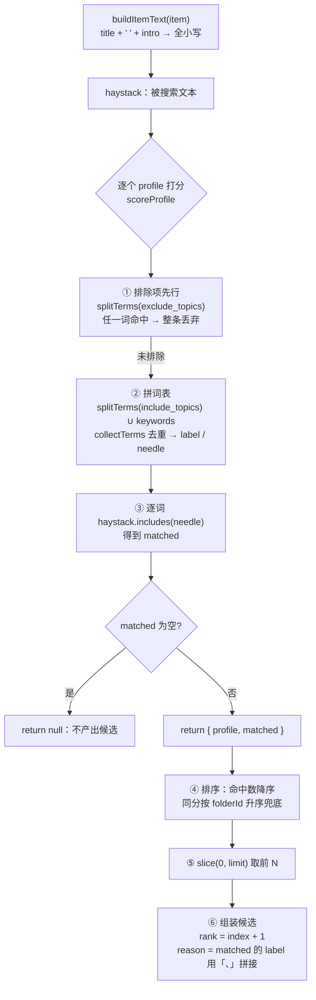

# 归位建议的匹配与分类逻辑

> 配套文档：[`suggest-item-target-contract.md`](./suggest-item-target-contract.md)（接口契约）、[`source-sync-and-organization-boundary.md`](./source-sync-and-organization-boundary.md)（整理边界）。
> 本文只讲**判断是怎么算出来的**，不讲接口形状。

## 1. 这段逻辑回答什么问题

```text
给定一条收藏项，它更适合放进哪些关键收藏夹？
```

它在 `suggest-item-target` 用例里是**唯一的判断环节**，其余步骤只负责取数与落库：

```text
suggestItemTarget                 (application/suggest-item-target.js)
├─ 1. normalizeContext            入参规范化
├─ 2. findItem                    取收藏项
├─ 3. listCompletedProfiles       取有资格参与比对的收藏夹
├─ 4. buildSuggestionCandidates   ★ 本文档描述的判断逻辑
├─ 5. persistCandidates           落库 item_suggestions
└─ 6. createSuggestionResult      组装返回值
```

第 4 步在 `domain/suggestion-policy.js`，是**纯函数**：不碰数据库、不生成 id、不落库。
这个边界是刻意的——判断逻辑可以脱离环境单独验证，换实现也不用动上下文。

## 2. 参与比对的两侧

| 角色             | 数据来源                                    | 参与方式                 |
| ---------------- | ------------------------------------------- | ------------------------ |
| 被搜索文本       | `source_items.title` + `source_items.intro` | 拼成 haystack，全小写    |
| 命中词表         | `folder_profiles.include_topics` + `keywords_json` | 提供 needle        |
| 排除词           | `folder_profiles.exclude_topics`            | 一票否决                 |
| 展示用收藏夹名   | `source_folders.title`                      | **不参与匹配**，仅回显   |

两条容易误判的边界：

- **`folder_profiles.purpose` / `notes` 不参与匹配。** 说明正文是给人和 Agent 读的自由文本，逐词拆开会引入大量噪音词（"这个"、"尽量"、"相关"）。一期只认 `include_topics` 与 `keywords` 这两个结构化程度更高的字段。
- **`source_folders.title` 不参与匹配。** 一个叫「前端工程」但 `include_topics` 为空的收藏夹，永远不会有候选。

## 3. 候选资格：谁才有资格被比

```sql
FROM folder_profiles AS p
JOIN source_folders   AS f ON f.id = p.folder_id
JOIN key_folders      AS k ON k.folder_id = p.folder_id
WHERE p.completed_at IS NOT NULL
```

同时满足两条：

1. 该收藏夹在 `key_folders` 里（用户选定为关键收藏夹）
2. `folder_profiles.completed_at` 非空（说明已填写完成）

这是"关键收藏夹只有说明填完后才参与建议"这条约束的落点，也是 `no_profile_completed` 原因码的来源。

## 4. 比对链路



对应 `suggestion-policy.js` 的三个函数：

| 函数                            | 职责                                                       |
| ------------------------------- | ---------------------------------------------------------- |
| `buildItemText(item)`           | 把收藏项文本压成一个可 `includes` 的小写字符串             |
| `splitTerms(rawText)`           | 自由文本按分隔符切词：`/[\s,，、;；/\|]+/`                  |
| `buildSuggestionCandidates(...)` | 编排：逐个打分 → 排序 → 截断 → 组装                        |
| `scoreProfile(profile, haystack)` | 单个收藏夹打分，`null` 表示"不产出候选"                    |
| `collectTerms(rawTerms)`        | 去重并生成 `{ label, needle }` 双形态                      |

## 5. 匹配的精确语义

**是子串包含（`String.includes`），不是分词后精确匹配。** 一期要的是可解释，不是覆盖率。

| 词表词   | 文本          | 命中 | 原因                       |
| -------- | ------------- | ---- | -------------------------- |
| `react`  | `Reactive`    | ✅   | 子串命中（假阳性）         |
| `工程`   | `工程化实践`  | ✅   | 中文无词边界，部分命中     |
| `前端`   | `前台接待`    | ❌   | 不是子串                   |
| `Vite`   | `vite 构建`   | ✅   | 大小写不敏感               |

**大小写不敏感。** `needle` 与 `haystack` 都转小写后比较；`exclude_topics` 的词在比较点现场 `.toLowerCase()`。

**双形态 `label` / `needle`。** `collectTerms` 为每个词生成两个值：

- `needle`：小写，只用于匹配
- `label`：用户原始写法，用于回显到 `evidenceTags` 与 `reason`

所以在库里写 `keywords: ["React"]`，界面上看到的是 `React` 而不是 `react`。

**去重是分值耦合点。** `collectTerms` 用 `Set` 按 `needle` 去重，因此同一个词无论写在 `include_topics` 还是 `keywords` 里、写几遍，都**只算 1 分**。如果去掉这层去重，用户把 `react` 同时写进两个字段就会让该收藏夹分数虚高、排序被带歪。

## 6. 打分与排序

```text
score = matched.length          // 命中词数，等权，无权重
```

排序键（两级，缺一不可）：

1. 命中词数降序
2. 同分时按 `folderId` 升序

第 2 级不是为了"更好"，而是为了**去掉随机性**——两个收藏夹都命中 2 个词时，不能让它俩的 rank 由数据库的返回顺序决定，否则同一份数据两次调用可能给出不同的 rank，落库的 `rank` 列也就不可信了。

截断：`slice(0, limit)`，`limit` 默认 3（`DEFAULT_CANDIDATE_LIMIT`）。落库表上另有 `UNIQUE (suggestion_group_id, rank)` 约束兜底。

> 注意：候选查询里 `ORDER BY f.sort_order ASC, f.id ASC` 只影响"打分顺序"，**不影响最终 rank**（最终排序被 folderId 兜底键重新决定）。

## 7. 三个出口

比对本身不产生候选时**不抛错**，而是由 application 层转成结构化原因：

| 出口                    | 触发条件                                  | 判定位置                      |
| ----------------------- | ----------------------------------------- | ----------------------------- |
| `item_not_found`        | `source_items` 里查不到该 `itemId`        | `findItem` 返回 null          |
| `no_profile_completed`  | 有资格比对的收藏夹数量为 0                | `listCompletedProfiles` 为空  |
| `no_candidate_matched`  | 有收藏夹可参与，但全部被排除或命中数为 0  | `buildSuggestionCandidates` 返回空数组 |

三个判断的顺序就是上面 1→2→3→4 的顺序，**先遇到哪个就返回哪个**。所以"收藏项不存在"永远优先于"没有候选"。

## 8. 完整走查示例

数据（取自 `suggest-item-target.test.js` 的第一个用例）：

```text
收藏夹 888「前端工程」  include_topics = "前端, 工程化"   keywords = ["react"]
收藏夹 999「随手拍」    include_topics = "摄影"          keywords = ["相机"]

收藏项 BV1  title = "前端工程化实践：React 与 TypeScript"
            intro = "vite 构建链路"
```

**第一步：拼 haystack**

```text
"前端工程化实践：react 与 typescript vite 构建链路"
```

**第二步：给 888 打分**

- ① exclude = `splitTerms("")` = `[]` → 不排除
- ② 词表 = `["前端", "工程化"]` ∪ `["react"]`
  → `collectTerms` → `[{label:"前端",needle:"前端"}, {label:"工程化",…}, {label:"react",needle:"react"}]`
- ③ 命中：`前端` ✅（"**前端**工程化实践"）、`工程化` ✅、`react` ✅ → **matched = 3**

**第三步：给 999 打分**

- ① exclude = `[]`
- ② 词表 = `["摄影"]` ∪ `["相机"]`
- ③ 命中 0 → **return null**，被 `.filter()` 丢弃

**第四步：排序 + 截断** → 只剩 888，`slice(0, 3)` 原样保留

**第五步：组装**

```json
{
  "folderId": "folder_888",
  "folderTitle": "前端工程",
  "rank": 1,
  "reason": "命中关键词：前端、工程化、react",
  "evidenceTags": ["前端", "工程化", "react"]
}
```

注意 999 是**对照组**：它的词表与视频完全不重叠，所以它被丢弃是匹配规则的结果，而不是被 `limit` 截掉的。

## 9. 当前设计的已知边界

| 现象                                     | 成因                                      | 一期是否接受                     |
| ---------------------------------------- | ----------------------------------------- | -------------------------------- |
| `react` 命中 `reactive`                  | 子串包含，无词边界                        | 接受，误报成本低                 |
| 说明词多的收藏夹天然占优                 | 分值是命中数，词库越大越容易命中          | 接受，但这是**真实偏差**         |
| 只写了 `purpose` 正文、没填关键词的收藏夹永远匹配不到 | `purpose` / `notes` 不参与匹配 | 接受，靠初始化引导用户填结构化字段 |
| 排除词也是子串匹配                       | 与命中同源                                | 接受                             |
| 英文缩写与中文混排无归一化               | 无同义词表                                | 接受，一期不引入词典             |

## 10. 后续替换点（为 Agent 匹配预留）

`buildSuggestionCandidates({ item, profiles, limit })` 的函数签名就是**替换缝**：

```text
入参：item（文本）+ profiles（收藏夹画像数组）
出参：candidates（同形状数组）
```

- **现在**：规则实现，纯函数、无 IO、可单测
- **将来**：Agent 实现读同一份入参形状，产出同形状的 candidates
- **已经预留的**：`suggestion_generated_by` 枚举里已有 `rules` / `hybrid` / `ai`，契约里 `generatedBy` 直接透传

要在二期接 Agent，真正需要提前想好的是 **`profiles` 里带什么信息**：现在的 `listCompletedProfiles` 只取了词表（`include_topics` / `exclude_topics` / `keywords`），而模型更需要 `folderTitle` / `purpose` / `notes` 这些语义描述。**字段一旦不取，换实现时就要连着改取数层**——这是当前数据结构最需要提前确定的地方。

## 11. 验证落点

| 内容         | 位置                                                    |
| ------------ | ------------------------------------------------------- |
| 判断逻辑     | `apps/server/src/domain/suggestion-policy.js`           |
| 编排与落库   | `apps/server/src/application/suggest-item-target.js`    |
| 用例测试     | `apps/server/src/application/suggest-item-target.test.js` |
| 运行测试     | `pnpm test`                                             |
